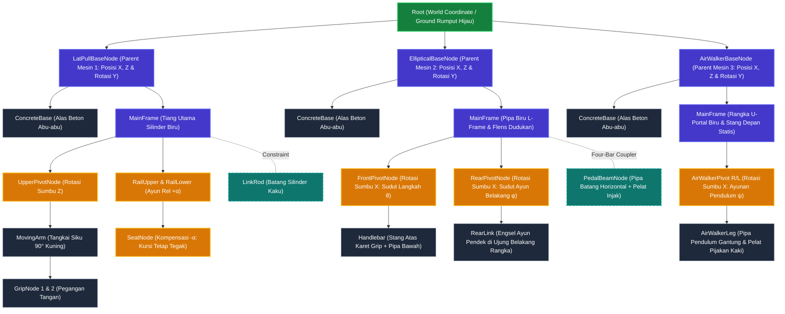

# Dokumentasi Hierarki Objek dan Mekanika Kinematika
**Mesin Outdoor Fitness: Lat Pull Down, Outdoor Elliptical, & Outdoor Air Walker**  
*Mata Kuliah Grafika Komputer – Implementasi WebGL2 & Scene Graph (Hierarchical Modelling)*

---

## 1. Konsep Hierarki Dunia & Penempatan Objek (*World Space & Placement*)

Di dalam dunia 3D (*World Space*), terdapat tiga objek peralatan kebugaran *outdoor* yang ditempatkan saling berdampingan di atas satu lantai rumput hijau yang sama:

1. **Mesin 1:** `LatPullBaseNode` (*Lat Pull Down / Chest Press*) – Default: $X = -3.2\text{ m}$.
2. **Mesin 2:** `EllipticalBaseNode` (*Outdoor Elliptical Trainer*) – Default: $X = 0.0\text{ m}$.
3. **Mesin 3:** `AirWalkerBaseNode` (*Outdoor Air Walker / Space Walker*) – Default: $X = +3.2\text{ m}$.

### Sifat Pewarisan Matriks (*Matrix Stack Property*):
* **Pemindahan Base (Parent Node / Keyboard WASD):**
  Setiap alat kebugaran dapat dipilih secara bergantian (tombol `1`, `2`, atau `3`). Ketika koordinat translasi $[X, Y, Z]$ atau rotasi $Y$ dari node `Base` diubah (melalui keyboard `W/A/S/D` & `Q/E` atau slider antarmuka), seluruh komponen di atasnya—meliputi alas beton abu-abu, rangka tiang biru, poros engsel, tuas stang, rel, kursi, hingga pedal—**otomatis ikut berpindah dan berputar bersama base secara serempak**. Hal ini terjadi karena perkalian matriks secara berjenjang:
  $$\mathbf{M}_{\text{child\_world}} = \mathbf{M}_{\text{base\_world}} \times \mathbf{M}_{\text{child\_local}}$$
* **Pergerakan Sendi / Lengan (Child Joints):**
  Sebaliknya, ketika sudut stang ditarik atau diayunkan maju-mundur, perubahan transformasi lokal hanya terjadi pada level *joint/child node* ke bawah. **Alas beton dan rangka dasar tetap diam kokoh di tempatnya di atas tanah hijau.**

---

## 2. Struktur Pohon Hierarki Lengkap (*Scene Graph*)

---

## 3. Desain Lengan Overhead Lat Pull Down (Sesuai Foto Asli)

Sesuai dengan referensi foto peralatan *outdoor fitness* yang diunggah, lengan penarik (`MovingArm`) dirancang sebagai **Wide-Grip Overhead Lat Pulldown Bar**:
1. **Dual Boom Struts:** Dua pipa perak memanjang ke depan dari poros engsel atas ($X = 0 \to 0.84\text{ m}$) dengan penguat gusset.
2. **Palang Melintang Tengah:** Palang lurus melintang selebar $0.68\text{ m}$ ($Z = -0.34\text{ m} \to +0.34\text{ m}$).
3. **Sayap Pegangan Lebar (Angled Wide Grips ~18°):** Ujung luar stang menekuk miring ke bawah selebar total $1.16\text{ m}$ ($Z = \pm 0.58\text{ m}$) lengkap dengan karet grip hitam ergonomis untuk tarikan punggung (*latissimus dorsi*).
4. **Pegangan Sempit Sejajar (Parallel Neutral Grips):** Dua batang pegangan horizontal di bagian dalam ($Z = \pm 0.15\text{ m}$) dengan karet grip hitam untuk variasi tarikan *neutral grip*.

---

## 4. Panduan Kontrol Keyboard (Game-Style)
* `1` / `2` / `3` : Beralih memilih mesin (`1` = Lat Pull Down, `2` = Elliptical, `3` = Air Walker).
* `W` / `S` : Menggeser posisi Base maju / mundur (sumbu Z).
* `A` / `D` : Menggeser posisi Base ke kiri / kanan (sumbu X).
* `Q` / `E` : Memutar orientasi Base terhadap sumbu Y.
* `Spasi`  : Memulai / menjeda animasi otomatis (*Auto Animation*).
* `R`      : Mengembalikan posisi Base alat terpilih ke koordinat awal (*Reset*).
