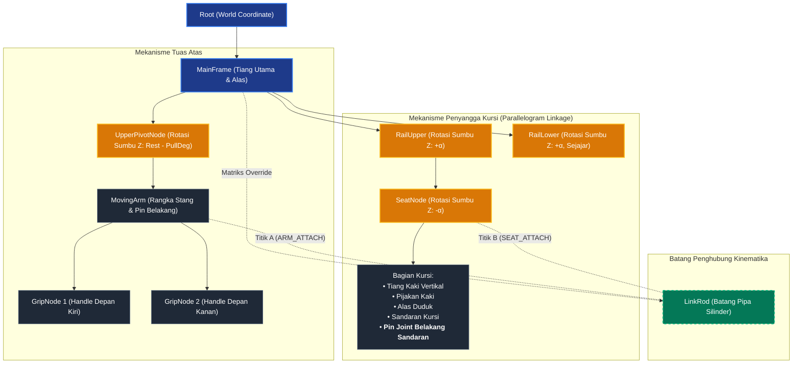

# Dokumentasi Hierarki Objek dan Mekanika Kinematika
**Mesin Outdoor Fitness: Lat Pull Down / Chest Press**  
*Mata Kuliah Grafika Komputer – Implementasi WebGL2 & Scene Graph*

---

## 1. Daftar Komponen / Elemen Mesin

Mesin kebugaran ini dimodelkan menggunakan sistem *procedural primitive meshes* (silinder, balok, dan bola) yang disusun menjadi struktur rangka ganda (sisi Kanan `R` dan Kiri `L` yang simetris):

| Komponen | Node Name | Keterangan & Bentuk Geometri |
| :--- | :--- | :--- |
| **Alas & Tiang Utama** | `MainFrame` | Alas beton penyangga, flens dasar, tiang silinder utama biru, tutup kubah kuning, serta bracket engsel atas (*clevis*) dan klem poros rel bawah. |
| **Poros Engsel Atas** | `UpperPivotNode` | Poros engsel tempat lengan tuas berputar. Terletak di bagian atas tiang ($Y = 2.20\text{ m}$). |
| **Lengan Tarik Utama** | `MovingArm` | Tuas stang dua sisi: sisi depan bercabang membentuk stang tarik, sisi belakang memiliki lengan pendek berisi pin sambungan atas (`ARM_ATTACH`). |
| **Pegangan Tangan** | `GripNode 1 & 2` | Karet grip hitam di ujung stang tarik dengan rotasi orientasi lokal $\pm 90^\circ$. |
| **Rel Ayun Atas** | `RailUpper` | Lengan penopang utama kursi di bagian atas. Berputar pada sudut $\alpha$. |
| **Rel Ayun Bawah** | `RailLower` | Lengan penopang penyeimbang di bagian bawah. Panjangnya sama persis dengan rel atas (`RAIL_LEN = 0.70 m`) dan selalu sejajar. |
| **Unit Kursi & Dudukan** | `SeatNode` | Terpasang di ujung `RailUpper`. Terdiri dari tiang kaki tegak, pijakan kaki bawah, bantalan alas duduk, tiang penyangga sandaran, sandaran kursi miring $6^\circ$, serta **pin/joint sambungan batang penarik di belakang sandaran** (`SEAT_ATTACH`). |
| **Batang Penarik** | `LinkRod` | Batang pipa kaku berpanjang tetap $L$ yang menghubungkan bagian belakang lengan stang (`MovingArm`) langsung ke bagian belakang sandaran kursi (`SeatNode`). |

---

## 2. Struktur Pohon Hierarki (*Scene Graph*)

Dalam Grafika Komputer, hubungan antar-objek direpresentasikan dalam bentuk graf pohon terarah (*Directed Tree*). Setiap *child node* mewarisi transformasi matriks (translasi, rotasi, skala) dari *parent node*-nya secara berjenjang (*Matrix Stack*).

### Diagram Pohon Hierarki:

---

## 3. Cara Kerja & Keterhubungan Antar-Mekanisme

Mekanisme mesin ini merupakan sistem **rantai kinematika tertutup (*Closed-Loop Kinematic Chain*) 4-batang**. Hubungan gerakannya bekerja melalui 4 tahapan berikut:

### 1. Masukan Gerak: Aksi Tuas Dua Sisi (*First-Class Lever*)
- Poros tumpuan berada di `UpperPivotNode`.
- Ketika pengguna menarik stang ke bawah sebesar sudut $\theta$ (`pullDeg`), ujung depan `MovingArm` turun.
- Karena bersifat tuas jungkat-jungkit, **pin tuas belakang (`ARM_ATTACH`, Titik $A$) justru bergerak terangkat ke atas dan membusur ke depan**.

$$\text{Rotasi}_Z(\text{UpperPivot}) = \text{REST\_DEG} - \theta$$

### 2. Penghubung Rigid: Batang Penarik (`LinkRod`)
- Batang penarik adalah benda tegar (*rigid body*) dengan panjang tetap $L$ yang dihitung saat inisialisasi awal:
  $$L = \|\mathbf{A}_{\text{rest}} - \mathbf{B}_{\text{rest}}\|$$
- Titik atas $A$ menempel pada tuas lengan stang (`MovingArm`).
- Titik bawah $B$ menempel langsung pada **pin sambungan di belakang sandaran kursi (`SeatNode`)**.
- Saat stang ditarik dan titik $A$ naik, batang `LinkRod` ikut tertarik ke atas dan **menarik sandaran kursi ke atas**.

### 3. Penjaga Keseimbangan: Mekanisme Jajar Genjang (*Parallelogram Linkage*)
- Kursi ditopang dari bawah oleh dua batang rel sejajar: `RailUpper` dan `RailLower`.
- Keduanya berputar serempak dengan sudut ayun $\alpha$ yang sama.
- Agar pengguna yang duduk di kursi tidak terjungkal ke depan atau ke belakang saat rel berayun, `SeatNode` diatur memiliki sudut kompensasi yang berlawanan persis dengan rel:

$$\text{Rotasi}_Z(\text{SeatNode}) = -\alpha$$

Dengan kompensasi sudut $\alpha + (-\alpha) = 0^\circ$, **orientasi kursi selalu tegak lurus sempurna terhadap lantai** di setiap titik gerakannya. Ketinggian angkat dudukan (*seat lift*) dihitung secara geometris:

$$\text{Lift} = \text{RAIL\_LEN} \cdot \sin(\alpha)$$

### 4. Penyelesaian Kinematika Numerik (*Bisection Solver*)
Karena ini rantai tertutup (*closed loop*), nilai sudut rel $\alpha$ dicari di setiap *frame* (60 FPS) menggunakan metode numerik **Bisection** pada file [`js/kinematics.js`](file:///D:/ZAKY/Materi%20Kuliah/5th%20Smt/5_Grafika%20Komputer/Hierarchy/js/kinematics.js):
1. Diberikan posisi titik $A(\theta)$ pada tuas atas.
2. Didefinisikan fungsi jarak $f(\alpha) = \|\mathbf{A} - \mathbf{B}(\alpha)\|$.
3. Komputer mencari nilai sudut $\alpha \in [-5^\circ, 70^\circ]$ sedemikian rupa sehingga:
   $$\|\mathbf{A} - \mathbf{B}(\alpha)\| = L$$
4. Setelah $\alpha$ ditemukan, matriks silinder `LinkRod` dihitung ulang (`pipeMatrix(A, B)`) agar membentang tepat dari pin tuas atas ke pin belakang sandaran kursi.

---

## 4. Mengapa `SeatNode` Menjadi Child dari `RailUpper` (Bukan `LinkRod`)?

Dalam grafika komputer, setiap node pada *Scene Graph* hanya dapat memiliki tepat 1 *parent*:

1. **Tumpuan Rangka Utama**:
   Di dunia nyata, berat badan pengguna dan kursi bertumpu secara struktural pada rangka rel bawah (`RailUpper` & `RailLower`), bukan menggantung seperti bandul ayunan pada pipa penarik.
2. **Kestabilan Transformasi Koordinat**:
   Jika `SeatNode` dijadikan *child* dari `LinkRod`, kursi akan mewarisi rotasi miring dari batang penarik (seperti bandul miring). Dengan menempatkan `SeatNode` sebagai *child* dari `RailUpper`, sifat jajar genjang mudah dipertahankan cukup dengan memutar lokal node sebesar $-\alpha$. Batang penarik (`LinkRod`) kemudian bertindak sebagai penghubung kinematis (*geometric constraint*).
