# Dokumentasi Hierarki Objek dan Mekanika Kinematika
**Mesin Outdoor Fitness: Lat Pull Down, Outdoor Elliptical, & Outdoor Air Walker + Urban Green Park Scenery**  
*Mata Kuliah Grafika Komputer – Implementasi WebGL2 & Scene Graph (Hierarchical Modelling)*

---

## 1. Konsep Hierarki Dunia & Penempatan Objek (*World Space & Placement*)

Di dalam dunia 3D (*World Space*), terdapat tiga objek peralatan kebugaran *outdoor* yang ditempatkan saling berdampingan di atas landasan karet kebugaran dan dikelilingi taman kota (*Urban Green Park*):

1. **Mesin 1:** `LatPullBaseNode` (*Lat Pull Down / Chest Press*) – Default: $X = -3.2\text{ m}$.
2. **Mesin 2:** `EllipticalBaseNode` (*Outdoor Elliptical Trainer*) – Default: $X = +0.5\text{ m}$.
3. **Mesin 3:** `AirWalkerBaseNode` (*Outdoor Air Walker / Space Walker*) – Default: $X = +3.2\text{ m}$.
4. **Scenery:** `UrbanParkEnvironmentNode` – Landasan matras karet merah bata (*EPDM*), *jogging track* paving melingkar, 6 pohon peneduh rimbun, 3 bangku taman, 4 lampu tiang menyala, semak-semak, plang informasi, serta **Kawasan Danau Alami (*LakeScenicArea*)** di sebelah timur taman lengkap dengan dermaga kayu (*pier*), perahu dayung (*rowboat*), angsa berenang, bunga teratai, buluh air, dan air mancur aerasi berkilau.

### Sifat Pewarisan Matriks (*Matrix Stack Property*):
* **Pemindahan Base (Parent Node / Keyboard WASD):**
  Setiap alat kebugaran dapat dipilih secara bergantian (tombol `1`, `2`, atau `3`). Ketika koordinat translasi $[X, Y, Z]$ atau rotasi $Y$ dari node `Base` diubah (melalui keyboard `W/A/S/D` & `Q/E` atau slider antarmuka), seluruh komponen di atasnya—meliputi alas beton abu-abu, rangka tiang biru, poros engsel, tuas stang, rel, kursi, hingga pedal—**otomatis ikut berpindah dan berputar bersama base secara serempak**. Hal ini terjadi karena perkalian matriks secara berjenjang:
  $$\mathbf{M}_{\text{child\_world}} = \mathbf{M}_{\text{base\_world}} \times \mathbf{M}_{\text{child\_local}}$$
* **Pergerakan Sendi / Lengan (Child Joints):**
  Sebaliknya, ketika sudut stang ditarik atau diayunkan maju-mundur, perubahan transformasi lokal hanya terjadi pada level *joint/child node* ke bawah. **Alas beton dan rangka dasar tetap diam kokoh di tempatnya di atas matras kebugaran.**

### Pemisahan File Objek
Builder tiap mesin disimpan terpisah di `js/objects/lat-pull.js`, `js/objects/elliptical.js`, `js/objects/air-walker.js`, dan lingkungan taman di `js/objects/environment.js`. Utilitas bersama seperti `Node`, material, serta `buildSceneHierarchy` tetap berada di `js/scene.js`.

---

## 2. Struktur Pohon Hierarki Lengkap (*Scene Graph*)

```mermaid
graph TD
    Root["Root (World Coordinate / Ground Rumput Hijau)"]

    %% Cabang Scenery Taman & Danau
    Root --> Env["UrbanParkEnvironmentNode (Scenery Taman & Danau)"]
    Env --> Pad["FitnessPad (Matras Karet EPDM Merah Bata)"]
    Env --> Track["JoggingTrackLoop (Paving Track Melingkar R=9.4m)"]
    Env --> Trees["ShadeTreesGroup (6 Pohon Peneduh Rimbun)"]
    Env --> Benches["ParkBenchesGroup (3 Bangku Kayu & Besi)"]
    Env --> Lamps["StreetlampsGroup (4 Tiang Lampu Lentera Menyala)"]
    Env --> Bushes["ParkBushesGroup (Semak Lanskap Asri)"]
    Env --> Amen["ParkAmenities (Plang Info & Tempat Sampah Pilah)"]
    Env --> Lake["LakeScenicArea (Kawasan Danau Alami & Waterfront)"]
    Lake --> Water["LakeBasinAndWater (Permukaan Air Berkilau & Dasar Pasir)"]
    Lake --> Shore["LakesidePromenade (Jalur Paving & Tanggul Batu Kali)"]
    Lake --> Pier["LakesidePier (Dermaga Kayu & Perahu Dayung)"]
    Lake --> Bio["LakeFloraFauna (Teratai, Gelagah, Angsa & Air Mancur)"]

    %% Cabang Mesin 1: Lat Pull Down
    Root --> LPBase["LatPullBaseNode (Parent Mesin 1: Posisi X, Z & Rotasi Y)"]
    LPBase --> LPConcrete["ConcreteBase (Alas Beton Abu-abu)"]
    LPBase --> LPMain["MainFrame (Tiang Utama Silinder Biru)"]
    LPMain --> LPPivot["UpperPivotNode (Rotasi Sumbu Z)"]
    LPPivot --> LPArm["MovingArm (Tangkai Siku 90° Kuning)"]
    LPArm --> LPGrip["GripNode 1 & 2 (Pegangan Tangan)"]
    LPMain --> LPRailU["RailUpper & RailLower (Ayun Rel +α)"]
    LPRailU --> LPSeat["SeatNode (Kompensasi -α: Kursi Tetap Tegak)"]
    LPMain -. Constraint .- LPRod["LinkRod (Batang Silinder Kaku)"]

    %% Cabang Mesin 2: Elliptical Trainer
    Root --> ELBase["EllipticalBaseNode (Parent Mesin 2: Posisi X, Z & Rotasi Y)"]
    ELBase --> ELConcrete["ConcreteBase (Alas Beton Abu-abu)"]
    ELBase --> ELMain["MainFrame (Pipa Biru L-Frame & Flens Dudukan)"]
    ELMain --> ELFront["FrontPivotNode (Rotasi Sumbu X: Sudut Langkah θ)"]
    ELFront --> ELHandle["Handlebar (Stang Atas Karet Grip + Pipa Bawah)"]
    ELMain --> ELRear["RearPivotNode (Rotasi Sumbu X: Sudut Ayun Belakang φ)"]
    ELRear --> ELRearLink["RearLink (Engsel Ayun Pendek di Ujung Belakang Rangka)"]
    ELMain -. Four-Bar Coupler .- ELPedal["PedalBeamNode (Pipa Batang Horizontal + Pelat Injak)"]

    %% Cabang Mesin 3: Outdoor Air Walker
    Root --> AWBase["AirWalkerBaseNode (Parent Mesin 3: Posisi X, Z & Rotasi Y)"]
    AWBase --> AWConcrete["ConcreteBase (Alas Beton Abu-abu)"]
    AWBase --> AWMain["MainFrame (Rangka U-Portal Biru & Stang Depan Statis)"]
    AWMain --> AWPivot["AirWalkerPivot R/L (Rotasi Sumbu X: Ayunan Pendulum ψ)"]
    AWPivot --> AWLeg["AirWalkerLeg (Pipa Pendulum Gantung & Pelat Pijakan Kaki)"]

    classDef world fill:#15803d,stroke:#22c55e,stroke-width:2px,color:#fff;
    classDef env fill:#047857,stroke:#10b981,stroke-width:2px,color:#fff;
    classDef base fill:#4338ca,stroke:#6366f1,stroke-width:2px,color:#fff;
    classDef joint fill:#d97706,stroke:#fbbf24,stroke-width:2px,color:#fff;
    classDef part fill:#1e293b,stroke:#64748b,stroke-width:1px,color:#fff;
    classDef link fill:#0f766e,stroke:#14b8a6,stroke-width:2px,stroke-dasharray: 5 5,color:#fff;

    class Root world;
    class Env,Pad,Track,Trees,Benches,Lamps,Bushes,Amen,Lake,Water,Shore,Pier,Bio env;
    class LPBase,ELBase,AWBase,LPMain,ELMain,AWMain base;
    class LPPivot,LPRailU,LPSeat,ELFront,ELRear,AWPivot joint;
    class LPConcrete,ELConcrete,AWConcrete,LPArm,LPGrip,ELHandle,ELRearLink,AWLeg part;
    class LPRod,ELPedal link;
```

---

## 3. Komponen Scenery Urban Green Park & Danau Alami

1. **Lantai Kebugaran Karet Merah Bata (*EPDM Tartan Mat*):**
   * Pelat persegi panjang ($10.4\text{ m} \times 4.8\text{ m}$) dengan tepi pembatas gelap dan garis pemisah antar-alat kebugaran.
2. **Paving Track Melingkar (*Jogging Track*):**
   * Lintasan elips melingkar di sekeliling area olahraga ($R_X = 9.4\text{ m}, R_Z = 6.6\text{ m}$, lebar $1.45\text{ m}$) dengan pembatas batu *kerb*.
   * Dilengkapi jalur paving penghubung (*access paths*) dari jogging track ke matras karet dan ke dermaga danau.
3. **Pohon Peneduh Rimbun (*Shade Trees*):**
   * 6 pohon peneduh di sekitar track dan 2 pohon peneduh tepi danau dengan tajuk daun bertumpuk bergradasi hijau tua dan hijau muda cerah.
4. **Bangku Taman Kayu (*Park Benches*):**
   * 3 bangku taman ergonomis di area fitness, 1 bangku santai di ujung dermaga, dan 1 bangku di bawah naungan pohon tepi danau selatan.
5. **Lampu Tiang Taman (*Streetlamps*):**
   * 4 tiang lentera klasik setinggi $3.4\text{ m}$ serta 1 tiang lentera pintu masuk dermaga dengan bohlam lentera bercahaya hangat (*unlit glow*).
6. **Kawasan Danau Alami Taman (*Scenic Park Lake & Waterfront*):**
   * **Cekungan & Air Berkilau (*Lake Basin & Layered Water*):** 5 cekungan elips organik berlapis pasir tepi danau, air dangkal toska, serta air dalam berkilau dengan pantulan spekular matahari (*Blinn-Phong specular*).
   * **Promenade & Tanggul Batu (*Shoreline Promenade & Boulders*):** Jalur paving pejalan kaki menyusuri tepi danau dan deretan bebatuan kali alami di sepanjang garis air.
   * **Dermaga Kayu (*Lakeside Pier*):** Jembatan dermaga kayu yang menjorok ke danau dengan tiang pancang kayu, 26 bilah papan geladak, pagar kayu pengaman, bollard tambat, dan bangku pandang.
   * **Perahu Dayung Tradisional (*Moored Wooden Rowboat*):** Perahu kayu klasik yang tertambat di sisi dermaga lengkap dengan bangku duduk, sepasang dayung kayu, dan tali tambat.
   * **Ekosistem Air (*Water Flora & Fauna*):** Koloni bunga teratai mekar merah muda dengan daun mengapung, rumpun tanaman gelagah rawa (*cattails*), sepasang angsa putih anggun berenang, dan air mancur aerasi tengah danau dengan 8 semburan lengkung.
7. **Fasilitas Pelengkap:**
   * Semak-semak hias rendah di kaki pohon dan tepi jalur.
   * Papan informasi selamat datang di depan pintu masuk.
   * Tempat sampah pilah dua tabung (organik & anorganik/daur ulang botol).

---

## 4. Panduan Kontrol Keyboard (Game-Style)
* `1` / `2` / `3` : Beralih memilih mesin (`1` = Lat Pull Down, `2` = Elliptical, `3` = Air Walker).
* `W` / `S` : Menggeser posisi Base maju / mundur (sumbu Z).
* `A` / `D` : Menggeser posisi Base ke kiri / kanan (sumbu X).
* `Q` / `E` : Memutar orientasi Base terhadap sumbu Y.
* `Spasi`  : Memulai / menjeda animasi otomatis (*Auto Animation*).
* `R`      : Mengembalikan posisi Base alat terpilih ke koordinat awal (*Reset*).
